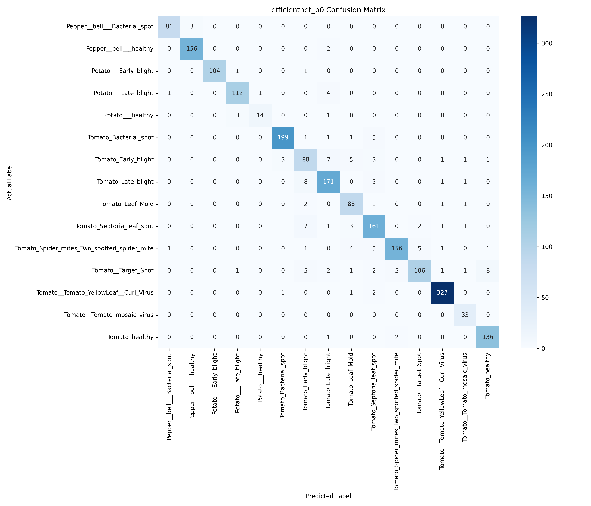

# PlantDiseaseNet

Deep Learning-based Plant Disease Detection using Computer Vision and Transfer Learning.

PlantDiseaseNet is a multi-class image classification project that identifies plant diseases from leaf images. It uses pretrained convolutional neural networks to classify leaf images into 15 disease and healthy-leaf categories.

## Project Goals

- Detect plant diseases from leaf images.
- Build image preprocessing and augmentation pipelines.
- Train and evaluate deep learning models.
- Compare CNN architectures using standard classification metrics.
- Identify the best-performing model for future deployment.

## Dataset

**Dataset:** PlantVillage

| Attribute | Details |
|---|---|
| Total images | 20,638 |
| Number of classes | 15 |
| Training images | 16,510 |
| Validation images | 2,063 |
| Test images | 2,065 |
| Image dimensions | 224 × 224 |
| Split ratio | 80% / 10% / 10% |

The dataset includes healthy and diseased leaves from pepper, potato and tomato plants.

Dataset files are excluded from GitHub and must be downloaded separately.

## Models

Two pretrained architectures were implemented using PyTorch and Torchvision:

- **MobileNetV2** – Lightweight convolutional neural network suitable for efficient image classification.
- **EfficientNet-B0** – Efficient convolutional neural network designed to balance model accuracy and computational cost.

### Training Configuration

| Parameter | Value |
|---|---|
| Framework | PyTorch |
| Pretrained weights | ImageNet |
| Input size | 224 × 224 |
| Batch size | 32 |
| Optimizer | Adam |
| Learning rate | 0.001 |
| Loss function | CrossEntropyLoss |
| Epochs | 10 |
| Hardware | NVIDIA Tesla T4 GPU |

The pretrained feature extractors were frozen, and the final classification layers were trained for the 15 target classes.

## Model Evaluation

Both models were evaluated on the same held-out test set containing 2,065 images.

### Performance Comparison

| Metric | MobileNetV2 | EfficientNet-B0 |
|---|---:|---:|
| Accuracy | 92.20% | **93.56%** |
| Macro Precision | 92.16% | **92.72%** |
| Macro Recall | 90.86% | **92.46%** |
| Macro F1-score | 91.26% | **92.45%** |

### Results

EfficientNet-B0 achieved the best overall test performance:

- Test accuracy: **93.56%**
- Macro precision: **92.72%**
- Macro recall: **92.46%**
- Macro F1-score: **92.45%**

Evaluation was performed using a held-out test set. EfficientNet-B0 is currently the preferred architecture based on the reported metrics.

### Confusion Matrices

**MobileNetV2**


**EfficientNet-B0**



EfficientNet-B0 outperformed MobileNetV2 across all four reported metrics.

## Project Structure

```text
PlantDiseaseNet/
│
├── app/                    # Model inference application
├── data/                   # PlantVillage dataset (not tracked)
├── models/                 # Trained model checkpoints (not tracked)
│
├── notebooks/
│   ├── week1/              # Dataset exploration
│   ├── week2/              # Preprocessing
│   ├── week3/              # CNN training
│   ├── week4/              # Transfer learning
│   └── week5/              # Trained model experiments
│
├── src/
│   ├── __init__.py
│   ├── dataset.py
│   ├── model.py
│   ├── train.py
│   ├── evaluate.py
│   └── utils.py
│
├── reports/
│   ├── figures/             # Confusion matrices and visualizations
│   └── results/             # Generated evaluation results
│
├── tests/                   # Project tests
├── README.md
├── requirements.txt
└── .gitignore
```

**Note:** Dataset files and trained model checkpoints are not committed to GitHub.

## Setup and Installation

### 1. Clone the repository

```bash
git clone https://github.com/RK065/PlantDiseaseNet.git
cd PlantDiseaseNet
```

### 2. Create a virtual environment

```bash
python3 -m venv venv
source venv/bin/activate
```

### 3. Install dependencies

```bash
pip install -r requirements.txt
```

### 4. Dataset Setup

Download the PlantVillage dataset and place it inside:

```text
data/PlantVillage/
```

### 5. Run the Training Pipeline

To train the EfficientNet-B0 model:

```bash
python -m src.train --model efficientnet_b0
```

## Roadmap

### Week 1 – Dataset Exploration

- Dataset collection and exploration.
- Initial exploratory data analysis.

### Week 2 – Preprocessing

- Image resizing and normalization.
- Dataset splitting and augmentation.

### Week 3 – Training Pipeline

- CNN training and evaluation pipeline.
- Reusable dataset and utility modules.

### Week 4 – Transfer Learning

- MobileNetV2 implementation.
- EfficientNet-B0 implementation.
- Training on GPU.

### Week 5 – Evaluation and Comparison

- Test-set evaluation.
- Classification reports and confusion matrices.
- Model performance comparison.
- Identification of the best-performing architecture.

### Week 6 – Deployment

- Develop a model inference interface.
- Explore web application deployment.

## Technologies Used

- Python
- PyTorch
- Torchvision
- NumPy
- Scikit-learn
- Matplotlib
- Jupyter Notebook
- Google Colab
- Git and GitHub

## Future Improvements

- Fine-tune selected pretrained backbone layers.
- Improve performance on challenging disease categories.
- Add image-based prediction through a web interface.
- Explore model optimization for deployment.

## Contributors

Developed as a collaborative machine learning project.